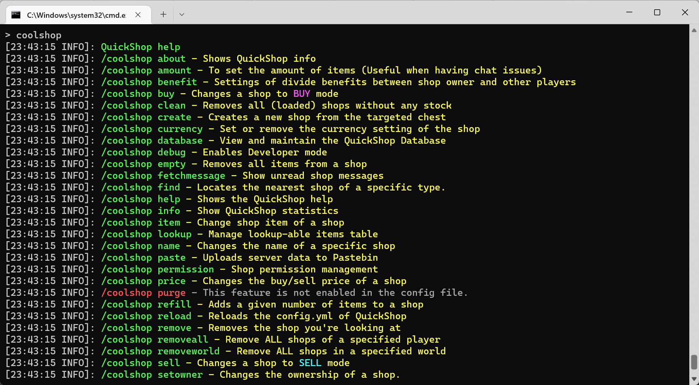

# Command Alias

By default, QuickShop will register the command prefix below:

* quickshop (root command, cannot remove or change it)
* qs
* shop
* chestshop
* cshop

## Register a new prefix or remove a prefix

All optional prefixes are defined in config.yml like this:

```yaml
# Command aliases for /qs main command.
custom-commands:
- qs
- shop
- chestshop
- cshop

# Command aliases for /qs sub-commands.
custom-subcommands:
  help: help
```

Simple add or remove prefix from `custom-commands` list, then you might need to restart your server to make it take effect.  
The effect should be like this:


