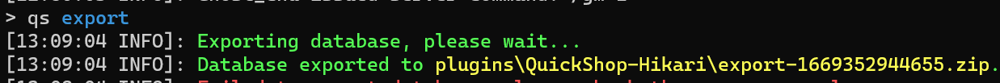

# Databases

QuickShop-Hikari supports two database types: `H2` and `MySQL`.

## Configuration

```yaml
# Database Configuration
# QuickShop supports:
# - H2 (local file database; simplest setup)
# - MySQL (recommended for large servers or networks)
database:
  # false = Use local H2 database
  # true  = Use MySQL database
  mysql: false
  # Database host (only required when mysql is true)
  host: localhost
  # Database port (only required when mysql is true)
  port: 3306
  # Database name (only required when mysql is true)
  database: quickshop
  # Database username (only required when mysql is true)
  user: root
  # Database password (only required when mysql is true)
  password: passwd
  # Table prefix. Set to "none" to remove prefix.
  # Each server must use a unique table prefix. Multiple servers cannot share the same table prefix.
  prefix: qs_
  # Use SSL for database connections (only required when mysql is true)
  usessl: false
  # Disable username caching in the database.
  disable-username-cache: false
  # Enable UUID caching/baking for faster lookups (advanced).
  bake-uuids: false
  # Loader service thread count:
  # -1 = Automatically choose a recommended value.
  # Advanced option—change only if you understand thread tuning.
  loader-threads: -1
  # Include full database info in /qs paste output.
  generate-full-report: false
  # Disable shutdown timeout while saving.
  # May cause the server to hang during shutdown.
  unlimited-save-wait: false
  # Skip database/table version checks.
  # Disabling is risky; support may not be provided.
  skip-version-check: false
  # Connection pool properties (HikariCP).
  # Advanced: tune for large servers if you know what you're doing.
  properties:
    connectionTimeout: 60000
    idleTimeout: 10000
    maxLifetime: 1800000
    maximumPoolSize: 10
    minimumIdle: 10
    cachePrepStmts: true
    prepStmtCacheSize: 250
    prepStmtCacheSqlLimit: 2048
    useUnicode: true
    characterEncoding: utf8
    allowPublicKeyRetrieval: true
    keepaliveTime: 60000
```

## Migrate

To migrate your QuickShop data from one database type to another, export the data and then import it into the new database.

Run `/quickshop export` in the console. QuickShop will create a ZIP archive containing the shop data.



Stop the server, switch the data source, and start the server again.  
The shops will initially appear to be missing because the new data source is empty; restore them from the export.

Rename the exported ZIP file to `recovery.zip`, run `/quickshop recovery`, and restart the server. All shops should then be restored.
