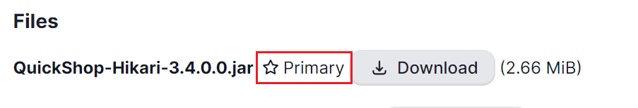
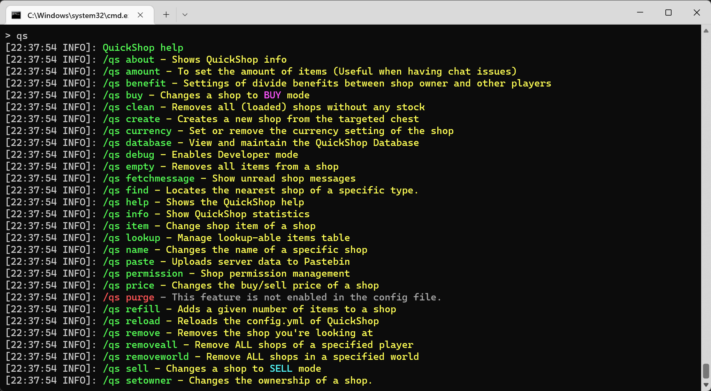

# Installation

This page will walk you through the process of installing QuickShop-Hikari on your PaperMC server.  

## Requirements

* A [Paper][paper]-based Minecraft server (1.20 or higher, Java 21)
* [VaultUnlocked][vault] to bridge QuickShop and your economy plugin. Do not install the original Vault alongside VaultUnlocked.
* For virtual item displays and per-player localization, you need a supported protocol library:
  * [ProtocolLib][plib]
  * [PacketEvents](https://www.spigotmc.org/resources/packetevents-api.80279/)
* A Vault-compatible economy plugin, such as [LiteEco][liteeco].
* A permission management plugin like [LuckPerms][luckperm].

This guide assumes that you are using compatible versions of QuickShop-Hikari, VaultUnlocked, LiteEco, a supported protocol library, and LuckPerms on Windows 11. The process is largely the same on Linux.

## Installing dependencies

Before installing QuickShop-Hikari, install [VaultUnlocked][vault] and [LiteEco][liteeco] for economy support, [ProtocolLib][plib] or [PacketEvents](https://www.spigotmc.org/resources/packetevents-api.80279/) for the optional display and localization features, and [LuckPerms][luckperm] for permission management. Do not install the original Vault alongside VaultUnlocked.

Download the plugins and place them in the `plugins` folder.

## Configuring the Display Protocol

If both ProtocolLib and PacketEvents are installed and you want to use PacketEvents for display items, set `shop.display-protocol: 'packetevents'` in `config.yml`.

## Installing QuickShop-Hikari

Download the latest version of QuickShop-Hikari from [Modrinth][qs-modrinth]. If several files have the `Compat-` prefix, ignore them during this step.  
The only file you need to download should have a **Primary** tag like this in the image below:



Drop the QuickShop jar into your `plugins` folder, start the server, then execute `qs` in the console. If you properly installed the plugin, a command help page will pop-up like this in the image below:



If you see any errors in the output, you can read the FAQ section or join our [Discord][dc] support server and ask them in the `#qsh-support` channel.

## Configure QuickShop to allow players to use it

By default, players are unable to create shops.

To allow players to create and own shops, you must grant the necessary permissions to them.

Fortunately, for most of the users, all you need to do is to run a simple command:

```mcfunction
/lp group default permission set quickshop.player true
```

and you're done! Players are now able to create and use shops, they will also have access to other features.

For advanced permission setup, you can check [here](permissions.md).

## All set! You are good to go!

Now QuickShop-Hikari is running on your server, for more settings, check the navigation panel on the left and see different sections.

[paper]: https://papermc.io/
[vault]: https://www.spigotmc.org/resources/vaultunlocked.117277/
[liteeco]: https://www.spigotmc.org/resources/liteeco-simple-economy-plugin-1-21-x.101934/
[plib]: https://www.spigotmc.org/resources/protocollib.1997/
[luckperm]: https://luckperms.net/
[qs-modrinth]: https://modrinth.com/plugin/quickshop-hikari
[dc]: https://discord.gg/Bu3dVtmsD3
