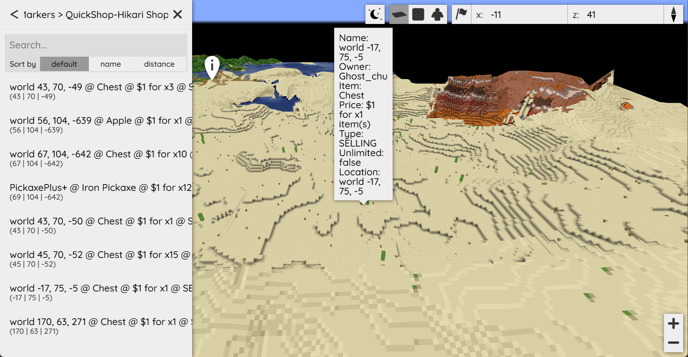

# BlueMap Addon

:::info

Can't find where to download the JAR? [Click here](../faq/where-addons-compacts-at).

:::

The BlueMap Addon allows QuickShop to display shops directly on your [BlueMap](https://modrinth.com/plugin/bluemap) web map.

Players can view:

- Shop locations
- Item being sold or bought
- Price
- Stock
- Owner
- Shop type

As of 6.2.0.11, the BlueMap addon now supports **colored markers based on shop state**.

---

## New in 6.2.0.11

The BlueMap addon now supports:

- Colored markers based on shop type/state
- Improved compatibility with the new ShopType system
- Better synchronization with the revamped event system
- More accurate updates when shop type changes

Markers now visually reflect:

- SELLING shops
- BUYING shops
- FROZEN shops

This makes it easier for players to understand shop behavior directly from the map.

---

## Showcase



---

## How It Works

When a shop is:

- Created
- Removed
- Updated
- Frozen or unfrozen
- Switched between BUYING/SELLING

The BlueMap addon automatically updates the marker.

Markers are:

- Added when shops are created
- Removed when shops are deleted
- Updated when price, stock, or type changes

No manual refresh required.

---

## Colored Markers

Markers can now display different colors depending on shop state.

Typical behavior:

- Selling shops → default color
- Buying shops → alternate color
- Frozen shops → disabled / muted color

This makes it easy to visually distinguish shop types on the map.

The color logic follows the new shop type system introduced in 6.2.0.11.

---

## Configuration

```yaml
config-version: 1

# If you want the marker set/markers to display by default when opening the map.
display-by-default: true

# Location for the image you want as your QuickShop marker.
# Default is inside the BlueMap assets folder.
icon-file-location: "/assets/chest.png"

# Display the marker icon on the map.
display-icon: true

# Maximum distance at which markers are visible.
# Lower values may improve performance on large servers.
max-distance: 1000

# Marker label shown in the marker list.
# Available placeholders:
# %item%, %price%, %stock%, %owner%, %type%, %location%
marker-label: "%item%, %price%, %stock%, %owner%, %type%"

# Popup text when clicking a marker.
marker-detail: '<span style="font-size: 120%">Chest Shop</span><hr><span>Owner: <strong>%owner%</strong></span><br><span>Item: <strong>%item%</strong></span><br><span>Price: <strong>%price%</strong></span><br><span>Stock: <strong>%stock%</strong></span><br><span>Type: <strong>%type%</strong></span><br><span>Location: <strong>%location%</strong></span>'

# How many times per second does the plugin refresh the shops?
refresh-per-seconds: 5
````

---

## Placeholders

The following placeholders are available:

* `%item%`
* `%price%`
* `%stock%`
* `%owner%`
* `%type%`
* `%location%`

These reflect live shop data and update automatically.

---

## Performance

To optimize performance:

* Lower `refresh-per-seconds` on large servers.
* Reduce `max-distance` to limit rendering range.
* Avoid extremely high shop density in a single area.

The addon is event-driven and only refreshes when necessary.

---

## Localization

The BlueMap Addon uses the `game-language` setting from your QuickShop configuration.

You can customize marker text via QuickShop’s Localization System:

See: `modules/localization.md`

---

## Installation

1. Install BlueMap.
2. Install the QuickShop BlueMap Addon.
3. Restart your server.

If BlueMap is not detected, the addon remains inactive.

---

## Summary

The BlueMap Addon:

* Displays shops on your web map
* Updates automatically
* Supports colored markers by shop state (6.2.0.11+)
* Integrates with the new shop type system
* Requires minimal configuration

It is recommended for servers that want a modern, web-based shop overview.
