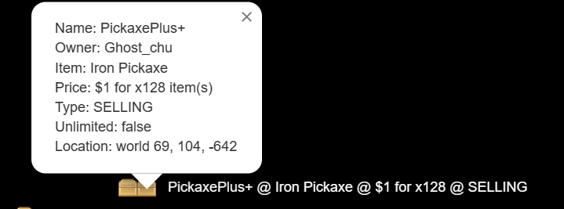

# Dynmap Addon

:::info

Can't find where to download the JAR? [Click here](../faq/where-addons-compacts-at).

:::

Dynmap Addon can display the shop on your [Dynmap](https://modrinth.com/plugin/dynmap) instance!

## Showcase



## Configuration

```yaml
config-version: 1
display-by-default: true
```

## Localization

The Dynmap addon uses the `game-language` setting in your QuickShop-Hikari configuration.

You can customize the string via QuickShop-Hikari's [Localization System](../../configuration/localization.md).
