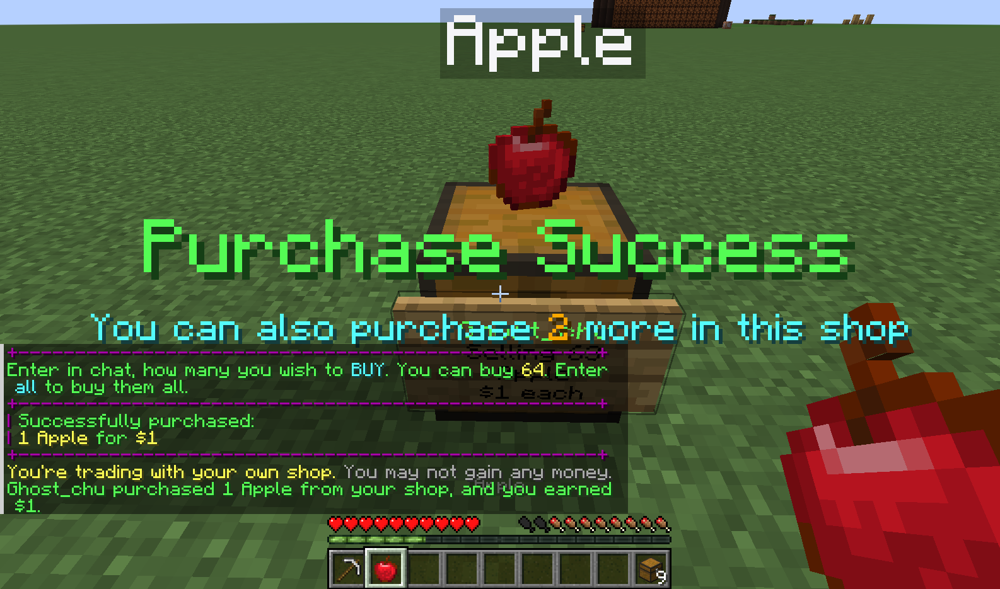
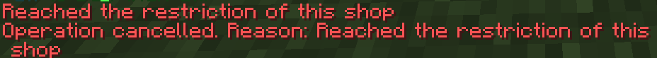

# Limited Addon

:::info

Can't find where to download the JAR? [Click here](../faq/where-addons-compacts-at).

:::

This addon allows store owners to set a limit on the number of sales for their store over a period of time.

## Permissions

* `quickshopaddon.limit.use` - Permission to use `/quickshop limit`

## Usage

### Permanent sales quantity limit

This restriction does not reset periodically.

Limit player purchases to a maximum of 32 items in this store:

```text
/quickshop limit set 32
```

### Periodic repetition limit

This restriction type allows resetting everyone's quota at certain intervals.

Limit players to purchasing up to 32 items per month:

```text
/quickshop limit set 32
/quickshop limit period MONTH
```

The system is based on the QuickShop-Hikari calendar system.  
The timing is updated using the "value change" update system, which means that 2022-12-31 to 2023-01-01 is also considered a year.  
Same for days, months and hours.

Available time units:

* ~~SECOND - 1 second~~ REMOVED DUE TO PERFORMANCE IMPACT. All existing and new second-based rules are updated every minute instead.
* MINUTE - 1 minute
* HOUR - 1 hour
* DAY - 1 day
* WEEK - 1 week
* MONTH - 1 month
* YEAR - 1 year

Due to a limitation of QuickShop-Hikari's calendar system, it is not possible to set custom intervals (for example, 3 days).

## Purchase Notice

When a player purchases from a store that has set a limit, the plugin will prompt the player with the remaining purchase quota after the purchase.



## Block the purchase

When the player exceeds or exhausts the purchase quota, the purchase will be blocked.


