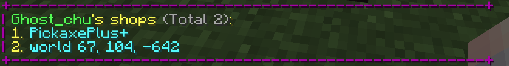
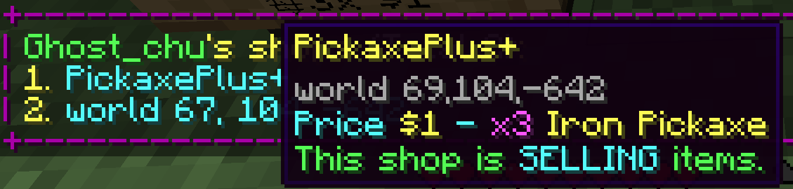
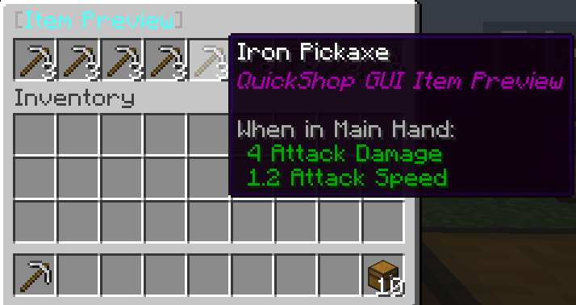

# List Addon

:::info

Can't find where to download the JAR? [Click here](../faq/where-addons-compacts-at).

:::

This addon added a command `/quickshop list` to allow the player or server administrator to listing all shops.

## Permissions

* `quickshopaddon.list.self` - The permission to use `/quickshop list` to query self shops
* `quickshopaddon.list.other` - The permission to use `/quickshop list <player_name>` to query others shops

## Listing

This addon can listing all shops that owned by specific player, and display in a list with shop name (or location for un-named shops).

## Simple Information

By hover your cursor on a entry, you will able to see the shop name, shop location, shop price, shop item, and shop type.

## Fast Preview

If a player can preview a shop (for example, by clicking **Preview Shop** in the purchase dialog), they can also preview it remotely by clicking its entry.

