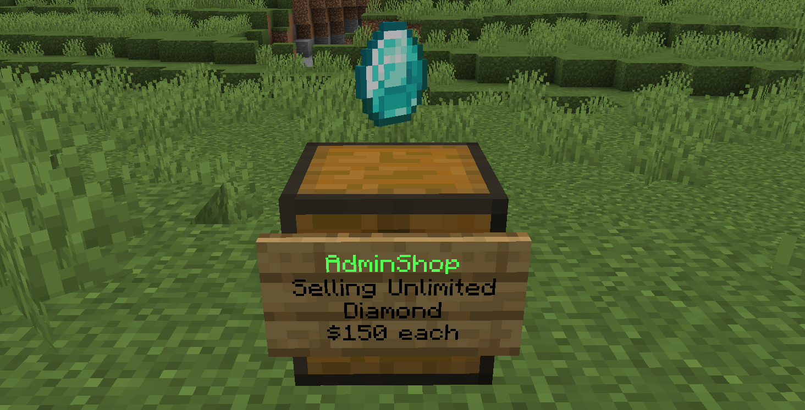
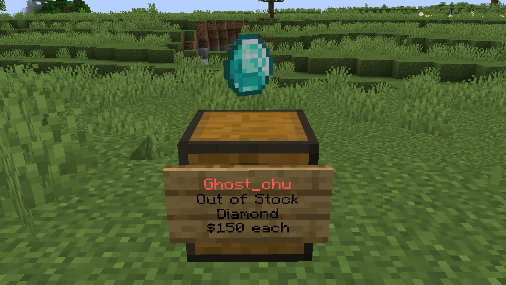

# Admin Shop (Unlimited Shop)

QuickShop provides a feature that allow you set a shop to unlimited space (for buying shop) or unlimited stock (for selling shop).

## Owner Mechanism

Even set a shop to admin shop, **the shop owner still is you!**  

## Set a shop to unlimited shop

Looking an quickshop and execute `/quickshop unlimited` to toggle that shop between limited or unlimited.

| Unlimited Shop                         | Limited Shop (Out of stock)            |
| -------------------------------------- | -------------------------------------- |
|  |  |

## Automatic change the owner when a shop turn to unlimited

You can enable `unlimited-shop-owner-change` in config.yml and set `unlimited-shop-owner-change-account` to the target player name or UUID. When enabled, switching a shop to "unlimited" will migrate its owner to the specified account.

This only applies to newly converted unlimited shops. Existing unlimited shops will not be changed automatically, and you must toggle the shop to unlimited again to apply the change.

The mechanic is not limited by the option that controls the maximum number of shops a player can create.
