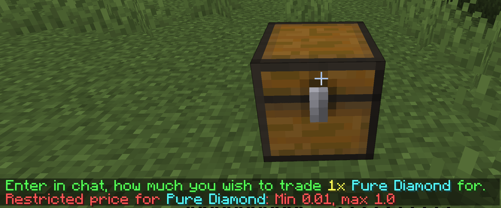

# Price Limiter

QuickShop provides a price limiter that lets you set minimum and maximum item prices on your server.



To edit the limit rules, you need to open `price-restriction.yml` file.

---

## Enable the limiter

The limiter is disabled by default. Enable it before configuring the rules.

```yaml
enable: true
```

---

## Define global price limits

You can set separate minimum and maximum prices for selling and buying shops.

```yaml
global: # These options are always enabled and are not controlled by the enable option
  selling:
    min: 0.01 # Can be zero if you want player create a free shop
    max: -1 # Actually this can be up to 1.7976931348623157E308
  buying:
    min: 0.01
    max: -1
```

---

## Create a rule

All rules are under the `rules` section in configuration.

You can set the default scope for rules that do not define their own scope.

```yaml
default-rule-scope: BUYING_AND_SELLING
```

Available scopes are `BUYING`, `SELLING`, and `BUYING_AND_SELLING`.

```yaml
rules: # Rules set
  example1: # Rules name, used for identifier and permission node (quickshop.price.restriction.bypass.<name>)
    items:
      - STONE_SWORD
      - STONE_PICKAXE
      - STONE_AXE
      - STONE_SHOVEL
      - STONE_HOE
    currency:
      - '*'
    scope: BUYING_AND_SELLING
    min: 1.0
    max: 50.0

  example2:
    items:
      - GOLDEN_SWORD
      - GOLDEN_PICKAXE
      - GOLDEN_AXE
      - GOLDEN_SHOVEL
      - GOLDEN_HOE
    currency:
      - '*'
    scope: SELLING
    min: 10.0
    max: 100.0

  example3:
    items:
      - DIAMOND_SWORD
      - DIAMOND_PICKAXE
      - DIAMOND_AXE
      - DIAMOND_SHOVEL
      - DIAMOND_HOE
    currency:
      - '*'
    scope: BUYING
    min: 10.0
    max: 100.0
```

`example1` and `example2` are rule names. You may replace them with any clear, unique names.

`scope` controls whether the rule applies to buying shops, selling shops, or both. If it is not provided, `default-rule-scope` is used.

`items` is a list of the items to which the rule applies.
The item name can be:

* Bukkit Material Name
* Item Reference tag (add `@` prefix)

The `currency` only works under Multi Currency mode.

`min` is the item's minimum price.
`max` is the item's maximum price.

All items in a rule share the same price limits. Create another rule to assign different limits.

---

# 🆕 Wildcard Support in Item Blacklist (6.2.0.11+)

QuickShop now supports wildcard pattern matching inside item configurations.

This allows you to block entire categories of items using simple patterns instead of listing every item manually.

## Supported Wildcards

| Pattern | Meaning                          |
| ------- | -------------------------------- |
| `*`     | Matches any number of characters |
| `?`     | Matches a single character       |

### Case-Insensitive Matching

Pattern matching is case-insensitive.

```text
*_axe
*_AXE
```

Both behave the same.

---

## Example Usage

Instead of writing:

```yaml
items:
  - WOODEN_AXE
  - STONE_AXE
  - IRON_AXE
  - GOLDEN_AXE
  - DIAMOND_AXE
  - NETHERITE_AXE
```

You can now simply write:

```yaml
items:
  - "*_AXE"
```

### More Examples

Block all spawn eggs:

```yaml
items:
  - "*_SPAWN_EGG"
```

Block all swords:

```yaml
items:
  - "*_SWORD"
```

Use single-character matching:

```yaml
items:
  - "DIAMOND_SPAWN_EG?"
```

---

## Important Notes

* Wildcard patterns apply to Material names.
* They do not replace Item Reference (`@reference`) matching.
* Patterns are evaluated during rule matching.
* Wildcards reduce configuration size and improve maintainability.

---

## Permission

Players who have:

```text
quickshop.price.restriction.bypass.<rule-name>
```

can ignore that rule's limitation.
