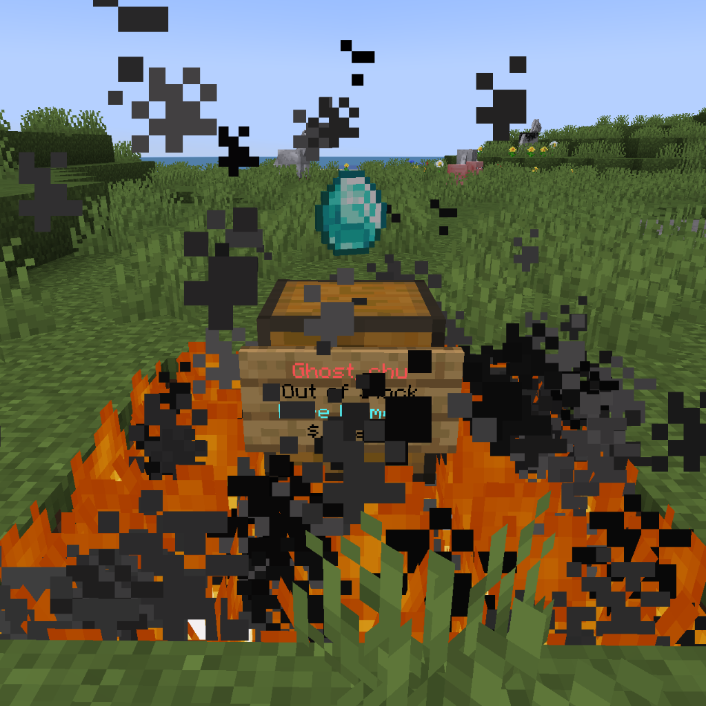
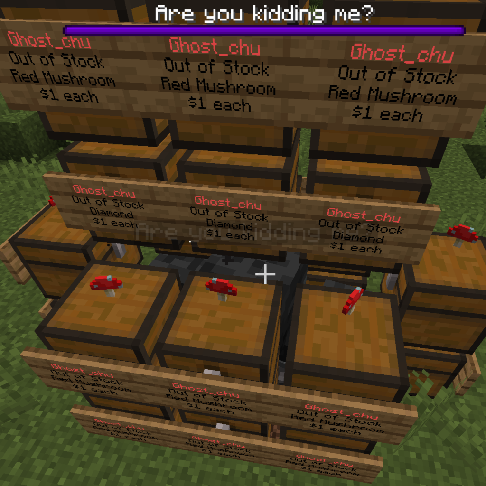
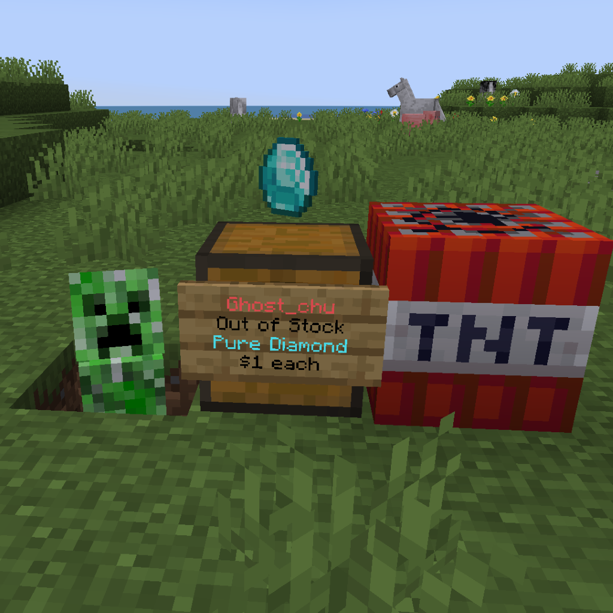
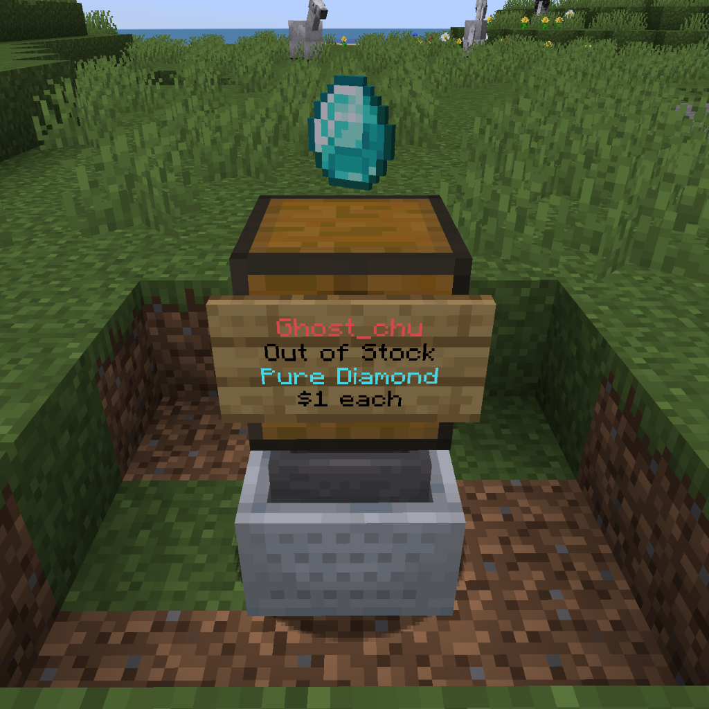

# Shop Protection

QuickShop-Hikari includes several layers of protection to prevent shop containers and signs from being damaged, accessed, or modified in unintended ways.

## Player Protection

By default, players who do not own a shop or have the required permissions cannot remove another player's shop.

QuickShop can also lock shop containers to prevent unauthorized players from opening the container, adding items, or removing items.

This behavior is controlled by:

```yaml
shop:
  # Lock shop containers from non-owners.
  # This prevents players from stealing from them.
  lock: true
```

Setting:

```yaml
shop:
  lock: false
```

disables QuickShop's normal container locking behavior.

## Protection Types

QuickShop can protect shops from several environmental and inventory-transfer behaviors, including:

- explosions;
- hopper transfers;
- dropper transfers;
- entity-related damage;
- copper oxidation.

The protected behaviors are illustrated below:

| Block | Entity | Explode | Hopper <br />(includes Hopper Minecart) |
| --- | --- | --- | --- |
|  |  |  |  |

These protections are configured under the top-level:

```yaml
protect:
```

section in `config.yml`.

The current default configuration is:

```yaml
protect:
  explode: true
  hopper: true
  hopper-owner-exclude: false
  dropper: true
  dropper-owner-exclude: false
  entity: true
  oxidation: true
```

## Explosion Protection

```yaml
protect:
  explode: true
```

When enabled, QuickShop protects shop blocks from explosion-related destruction.

Set it to:

```yaml
protect:
  explode: false
```

to disable QuickShop's explosion protection.

## Hopper Protection

```yaml
protect:
  hopper: true
```

When enabled, QuickShop protects shop inventories from unauthorized hopper-based item transfers.

This includes hopper-related inventory movement that could otherwise insert items into or extract items from a shop container.

### Allowing Owner Hoppers

The related option:

```yaml
protect:
  hopper-owner-exclude: false
```

controls whether hopper protection should exclude hoppers belonging to the shop owner.

With the default:

```yaml
hopper-owner-exclude: false
```

QuickShop continues applying its hopper protection normally.

Set:

```yaml
hopper-owner-exclude: true
```

when shop-owner hoppers should be excluded from this protection.

## Dropper Protection

```yaml
protect:
  dropper: true
```

When enabled, QuickShop protects shop inventories from dropper-based item transfers.

This prevents droppers from being used to bypass the normal protections surrounding a shop's inventory.

### Allowing Owner Droppers

Dropper protection has its own owner-exclusion option:

```yaml
protect:
  dropper-owner-exclude: false
```

With the default:

```yaml
dropper-owner-exclude: false
```

QuickShop applies dropper protection normally.

Set:

```yaml
dropper-owner-exclude: true
```

when droppers belonging to the shop owner should be excluded from the protection.

:::note
`hopper-owner-exclude` and `dropper-owner-exclude` are independent settings. Allowing an owner's hopper does not automatically allow an owner's dropper, and vice versa.
:::

## Entity Protection

```yaml
protect:
  entity: true
```

When enabled, QuickShop protects shop blocks from entity-related destruction or modification handled by the shop protection system.

Set it to `false` to disable this protection.

## Copper Oxidation Protection

```yaml
protect:
  oxidation: true
```

When enabled, QuickShop prevents copper shop containers from naturally oxidizing while they are being used as shops.

This keeps the copper block in the state it had when used for the shop instead of allowing normal oxidation to change the block over time.

Set:

```yaml
protect:
  oxidation: false
```

if copper shop blocks should be allowed to oxidize normally.

:::info
Oxidation protection is only relevant to shop blocks that support Minecraft's copper oxidation behavior.
:::

## Complete Protection Configuration

A typical configuration with all protection types enabled is:

```yaml
protect:
  explode: true
  hopper: true
  hopper-owner-exclude: false
  dropper: true
  dropper-owner-exclude: false
  entity: true
  oxidation: true
```

Each protection can be configured independently.

## Protection Checking

QuickShop also includes a protection checker used when determining whether a player is allowed to create or interact with a shop in a protected area.

By default, QuickShop sends a simulated `BlockBreakEvent` to determine whether another protection plugin permits the player to modify the block.

```yaml
shop:
  protection-checking: true
```

This helps QuickShop work with protection systems even when a dedicated compatibility module is not installed.

:::caution
Disabling protection checking is not recommended unless you are using another integration or protection mechanism that reliably handles shop placement.

Without protection checking, players may be able to create shops on containers inside regions, claims, towns, plots, spawn areas, or other locations where they normally cannot modify blocks.
:::

To disable the generic protection checker:

```yaml
shop:
  protection-checking: false
```

## Protection Checking Blacklist

Protection checking can be disabled in specific worlds:

```yaml
shop:
  protection-checking-blacklist:
    - disabled_world
```

This is useful when a world does not use region protection or when a specific protection integration should handle checks instead.

## Listener Blacklist

QuickShop's simulated protection events may conflict with some plugins or listeners.

Specific listeners can be excluded with:

```yaml
shop:
  protection-checking-listener-blacklist:
    - ignored_listener
```

Entries can target a listener class, class prefix, plugin, or supported regular-expression pattern.

For example, an entire plugin can be excluded with:

```yaml
shop:
  protection-checking-listener-blacklist:
    - "@PluginName"
```

Or a specific listener can be excluded:

```yaml
shop:
  protection-checking-listener-blacklist:
    - "com.example.protection.BlockBreakListener"
```

## Summary

QuickShop-Hikari's shop protection system can protect shops from:

| Protection | Setting |
| --- | --- |
| Explosions | `protect.explode` |
| Hopper transfers | `protect.hopper` |
| Owner hopper exclusion | `protect.hopper-owner-exclude` |
| Dropper transfers | `protect.dropper` |
| Owner dropper exclusion | `protect.dropper-owner-exclude` |
| Entity-related damage | `protect.entity` |
| Copper oxidation | `protect.oxidation` |

For most servers, keeping these protections enabled provides the safest default behavior.
