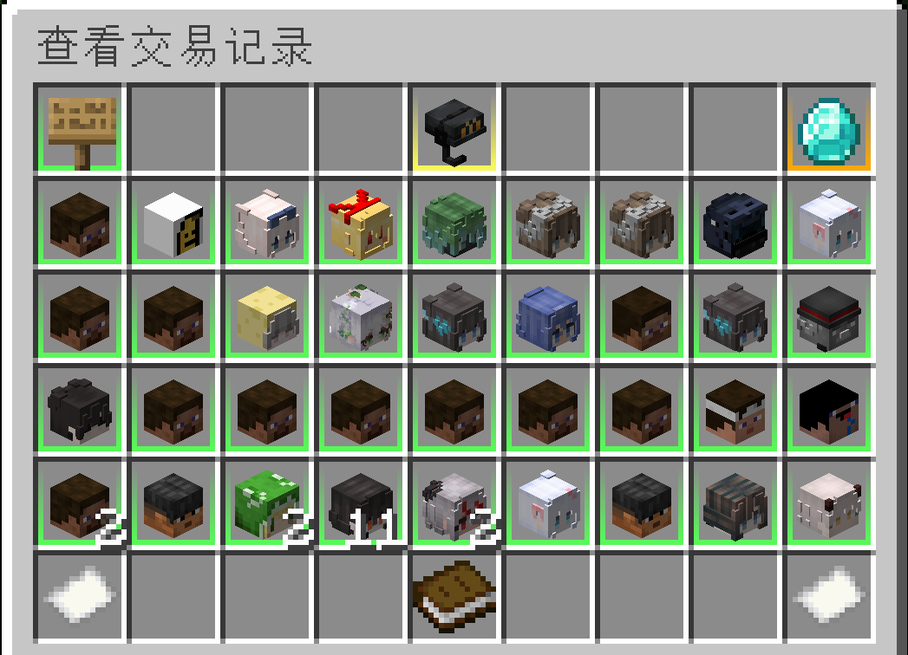
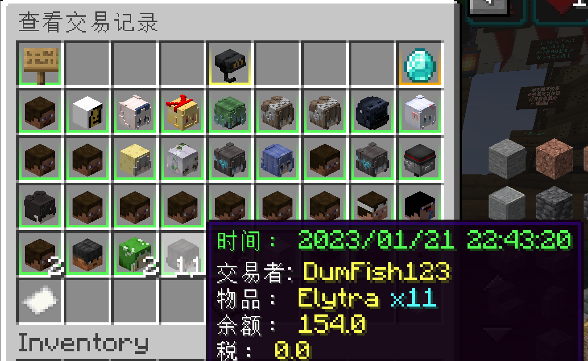
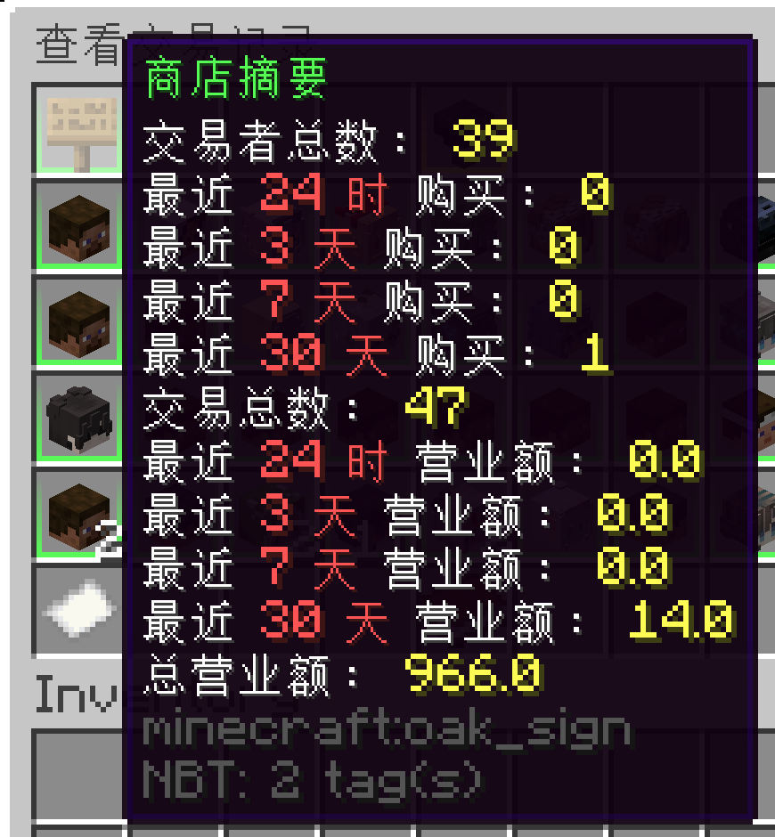
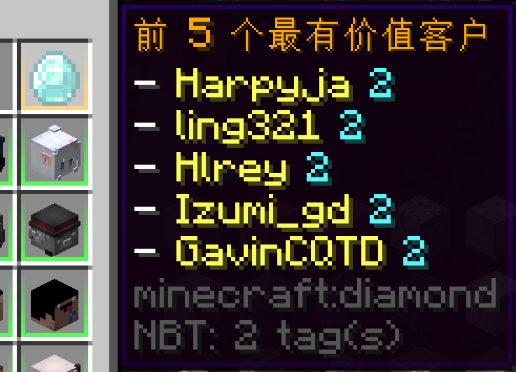

# Shop History

The Shop History system allows players and staff to review past transactions in a visual GUI.

It provides full transaction transparency, including:

- Purchaser
- Item
- Quantity
- Price
- Taxes
- Timestamp
- Shop location
- Shop summary statistics

The History interface is part of the GUI system and can be customized inside: `gui.yml`

Reference:

Localization is handled through: `messages.yml`

---

# Opening Shop History

## From the Control Panel

1. Right-click your shop.
2. Open the **Control Panel**.
3. Click the **History** button.

This opens the transaction history for that specific shop.

---

## Using Command

You can also query history using: `/quickshop history <sub-command>`

Available sub-commands:

- `owned` — View history of shops you own.
- `accessible` — View shops you have permission to access.
- `global` — View all shops on the server (requires admin permission).

This is useful for staff or large shop owners.

---

# History GUI Overview

The History GUI displays transactions as entries inside a paginated inventory menu.

Each entry represents one completed transaction.



---

## Transaction Details

Hovering over an entry displays:

- Transaction time
- Purchaser (player name)
- Item and amount
- Total price
- Taxes applied
- Shop coordinates (if viewing multiple shops)



If querying multiple shops:

- The icon may represent the shop item instead of the player head.
- Location data will be shown in the hover text.

---

# Shop Summary

In the top-left corner of the History GUI, hovering the summary item displays:

- Total purchases
- Unique purchasers
- Total turnover



This gives a quick overview of shop performance.

---

# Most Valuable Customers

In the top-right corner, hovering the diamond icon displays:

- Top 5 highest-spending customers
- Ranked by total transaction value



This is useful for:

- Reward systems
- VIP tracking
- Player analytics

---

# Permissions

Access depends on context:

- Shop owners → Can view their own shop history.
- Staff members → Can view history if granted permission.
- Admins → Can access global history via command.

If players cannot open history, verify:

- QuickShop permissions
- Per-shop access permissions
- Staff configuration

---

# GUI Customization

You can modify:

- Menu title
- Slot layout
- Navigation buttons
- Summary item
- Transaction entry formatting
- Pagination

All layout settings are controlled in: `gui.yml`

Reference:

Text and button names support the `lang:` prefix for localization:

```yaml
name: "lang:history.title"
```

Which pulls from: `messages.yml`

---

# Best Practices

- Keep history enabled for economic transparency.
- Allow staff to access `global` history for moderation.
- Use summary metrics to monitor inactive or suspicious shops.
- Combine with the new Tax System for full transaction tracking.

---

# Summary

The Shop History system provides:

- Complete transaction auditing
- Per-shop or multi-shop querying
- GUI-based browsing
- Summary analytics
- Most valuable customer tracking
- Full customization support

It is strongly recommended for all economy-focused servers.
