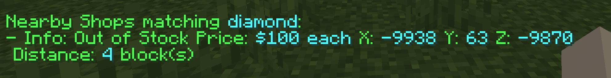
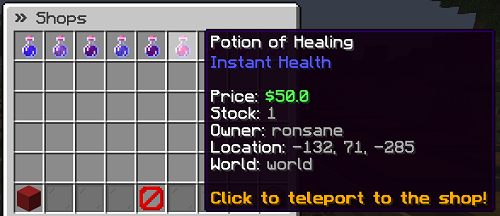

# Shop Search

QuickShop has a built-in shop search feature that lets you search the server's shops without loading chunks.  

## Usage

Execute command `/quickshop find <itemname>`.

## Item name

Currently it only supports English name, we not support i18n name yet!

## Third party addon

The [[QuickShop Addon] Shop Search by Ronsane](https://www.spigotmc.org/resources/95104/) addon is available on SpigotMC and provides advanced shop-search features.

